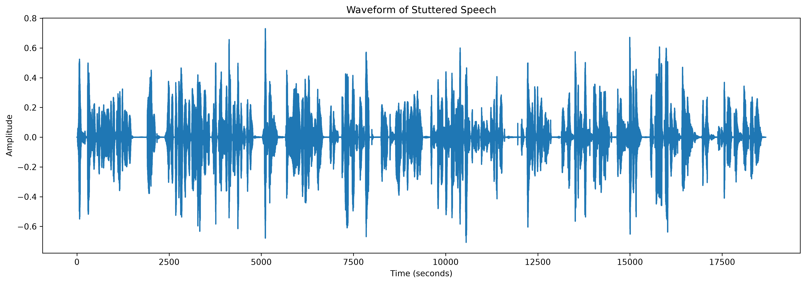
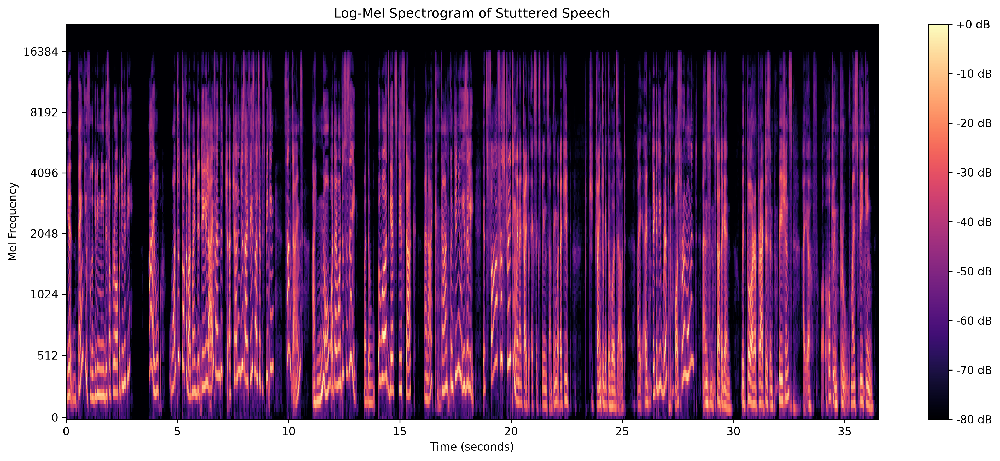

# From Voice to Text and Back
## ASR and TTS analysis of a speech sample with disfluencies

### Page 1 — Audio analysis, ASR, and CTC

#### Objective

The activity demonstrates an end-to-end speech technology pipeline on a short English recording containing observable disruptions to fluent speech. The goals are to inspect the audio, compare two automatic speech recognition (ASR) systems, explain Connectionist Temporal Classification (CTC), calculate word error rate (WER), and synthesize speech from recognized text. This is a technical demonstration only; it is not a clinical assessment of the speaker.

#### Input and signal analysis

The input is `D:\new_stutter.mp3`, a recording approximately 36.49 seconds long. Its decoded source rate is 44.1 kHz; the Wav2Vec2 pipeline resamples mono audio to 16 kHz. The waveform plots amplitude over time. The log-Mel spectrogram represents short-time spectral energy on a Mel-frequency scale, using 128 Mel bands, a 2048-sample FFT window, and a 512-sample hop. The plots show acoustic activity and pauses, but they do not independently identify or diagnose stuttering.

<table>
<tr>
<td></td>
<td></td>
</tr>
<tr><td align="center">Waveform</td><td align="center">Log-Mel spectrogram</td></tr>
</table>

#### ASR architectures and CTC

Two ASR paths are compared. Wav2Vec2 takes waveform samples, applies a convolutional feature encoder and Transformer context network, and emits character-level logits for CTC decoding. Whisper uses log-Mel audio features in an encoder-decoder Transformer and generates text tokens autoregressively. Whisper does not use CTC; the two approaches are parallel alternatives, not consecutive stages of one model.

CTC (Connectionist Temporal Classification) handles the unknown alignment between audio frames and output characters. Greedy decoding chooses the most likely token per frame, first merges consecutive repeated tokens, then removes blank tokens. For example, `A, A, blank, A, B, B` decodes to `AAB`. The blank separates the two A tokens, so removing blanks before merging repeats would give the wrong result. The example script [ctc_demo.py](../ctc_demo.py) shows this operation.

The full pipeline diagram is [ASR and TTS architecture](asr_architecture.svg).

\newpage

### Page 2 — Evaluation, TTS, and conclusion

#### ASR comparison and WER

The current reference contains 81 words. WER is calculated as:

**WER = (substitutions + deletions + insertions) / reference words**

| Model | Main decoding approach | Hits | Substitutions | Deletions | Insertions | WER |
|---|---|---:|---:|---:|---:|---:|
| Wav2Vec2-base-960h | CTC greedy decoding | 74 | 7 | 0 | 8 | 18.52% |
| Whisper base | Encoder-decoder token generation | 81 | 0 | 0 | 1 | 1.23% |

For the current provisional reference, Wav2Vec2 gives `(7 + 0 + 8) / 81 = 15 / 81 = 18.52%`; Whisper gives `(0 + 0 + 1) / 81 = 1 / 81 = 1.23%`. The saved result table is [wer_results.csv](../outputs/wer_results.csv).

**Evaluation limitation:** these numbers are not reliable final accuracy measurements. The local reference transcript is not included in the public repository, has not been independently verified against the recording, and closely follows the Whisper output. This biases the comparison in Whisper's favor. A human should listen to the original and correct a verbatim reference transcript, including the intended treatment of repetitions and disfluencies, before the WER is submitted as a valid model comparison.

#### Text-to-speech and conclusion

The Whisper transcript is passed into Windows System.Speech and saved locally as `outputs/tts_output.wav`. This completes the return path from recognized text to synthesized speech. The generated voice is synthetic; it is not the original speaker and does not reproduce the original disfluencies. Speech-derived transcripts and TTS audio are deliberately excluded from the public repository.

The project now includes audio feature extraction and plots, two ASR implementations and outputs, a CTC decoding demonstration, a WER comparison script and table, a generated TTS audio file, an ASR/TTS architecture diagram, this two-section mini-report, a runnable Jupyter/Colab notebook, and a timed presentation script. Run instructions and timing cues are in [three_minute_demo.md](three_minute_demo.md).

The major remaining scientific limitation is the lack of a verified ground-truth transcript. Until that is corrected, report the WER values as provisional examples of the calculation rather than evidence that one recognizer is definitively more accurate.
